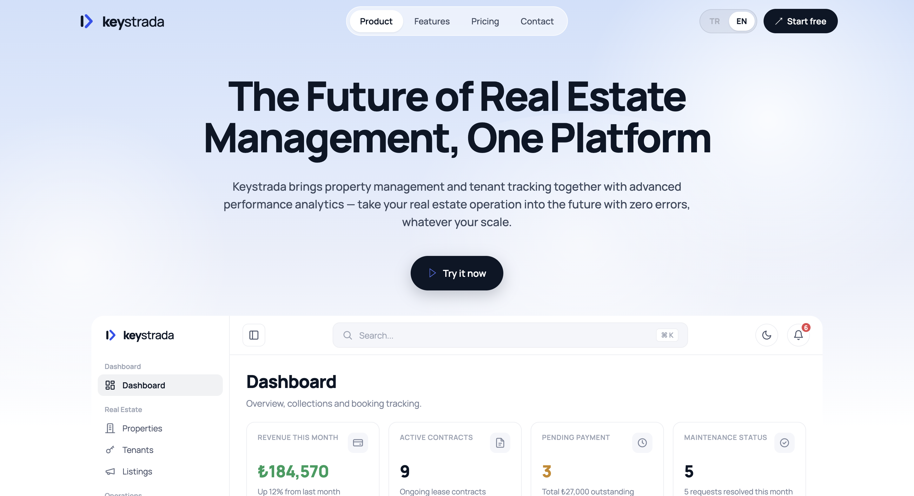
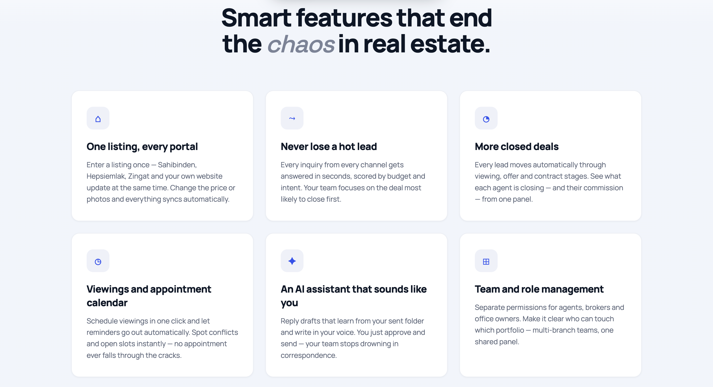
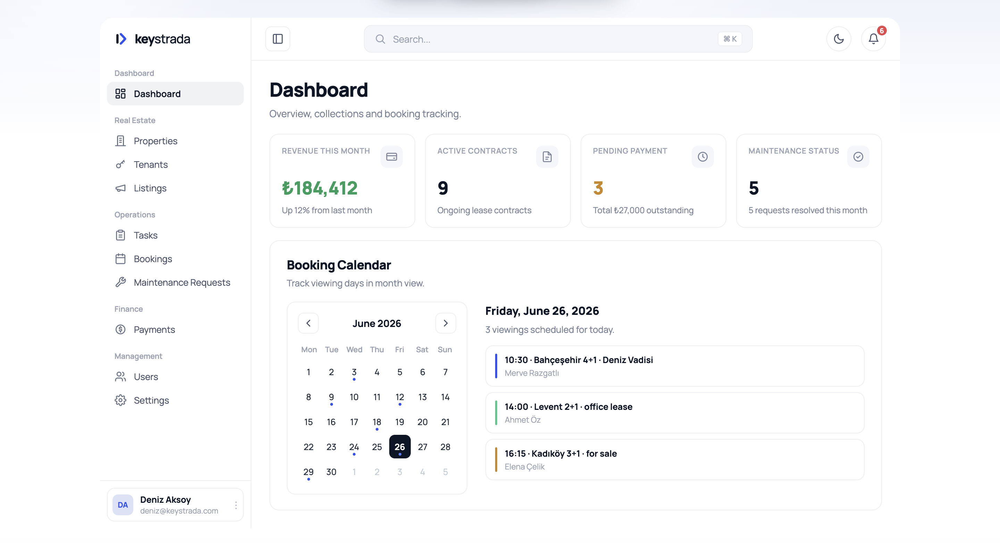

# Keystrada — Yapay Zeka Destekli Mülk ve Kiracı Yönetim Platformu

Emlak yönetim şirketlerinin ve mülk sahiplerinin kiracı takibi, kira sözleşmeleri, tahsilat,
bakım talepleri ve kira dekontu eşleştirme süreçlerini **tek bir panelden** yönetmesini sağlayan
uçtan uca bir SaaS platformu.

**Ekip:** İki kişilik geliştirme ekibi — **Furkan Turan** & **Yaşar Samed Erol**. İkimiz de
hem frontend hem backend üzerinde birlikte çalıştık; tasarımdan API'ye, veritabanı şemasından
yapay zeka modülüne kadar sistemin tamamı ortak geliştirildi.

[🇬🇧 English version](README.en.md)

---

## ⚠️ Bu Repo Hakkında

Bu depo **yalnızca portfolyo/tanıtım amaçlıdır**. Projenin kaynak kodu, müşteri verileri ve
kişisel verilerin korunması (KVKK) kapsamındaki kayıtlar nedeniyle **paylaşılmamaktadır**.
Burada yalnızca sistemin mimarisi, kullanılan teknolojiler, çözülen problemler ve arayüzden
ekran görüntüleri yer alır.

---

## Problem & Çözüm

Emlak ofislerinde ve mülk sahiplerinde kiracı bilgisi, kira sözleşmesi, ödeme takibi ve bakım
talepleri genellikle Excel, WhatsApp ve kağıt üzerinde dağınık şekilde yürütülüyor. Bu durum
kayıp bilgiye, tahsilat gecikmelerine ve özellikle **kira dekontlarının hangi kiracıya/mülke ait
olduğunun manuel olarak tek tek kontrol edilmesi** gibi zaman kaybettiren işlere yol açıyor.

Keystrada bu süreçlerin tamamını tek bir sistemde topluyor ve projenin en özgün parçası olarak,
banka dekontu PDF'lerini **OCR + NLP tabanlı yapay zeka modülü** ile otomatik okuyup güven
skoruna göre doğru kiracı ve mülkle eşleştiriyor — muhasebe ekibinin elle yaptığı eşleştirme
işini büyük ölçüde ortadan kaldırıyor.

---

## Rol Bazlı Üç Farklı Kullanım Deneyimi

| Rol | Erişim |
|---|---|
| **Admin** | Sistemin tamamı: personel, raporlar, tüm mülk ve finans verisi |
| **Emlakçı** | Portföy yönetimi — mülkler, kiracılar, ilanlar, kira sözleşmeleri, bakım, randevu, tahsilat (kısıtlı personel/rapor erişimi) |
| **Kiracı** | Kendi kira sözleşmesi, ödeme geçmişi ve bakım taleplerini gördüğü ayrı bir kiracı paneli |

Rol kontrolü sadece arayüzde gizleme değil; middleware seviyesinde rota koruması, sayfa
seviyesinde guard bileşenleri ve dinamik (rol bazlı filtrelenen) sidebar/komut paleti ile uçtan
uca uygulanıyor.

---

## Modüller

| Modül | Ne yapıyor |
|---|---|
| **Dashboard** | Rol bazlı özet: aktif sözleşme, tahsilat durumu, bakım talebi, gelir/gider trendi |
| **Mülkler** | Daire/apart/villa/arsa/işyeri kaydı, çok birimli (apartman/plaza) yönetim, görsel galerisi, notlar |
| **İlanlar** | Mülkten satış/kiralama ilanı oluşturma, özellik (JSON) alanları, yayın durumu |
| **Kiracılar** | Kiracı profili, belge arşivi (kimlik, ikametgah, sözleşme), kiracıya özel notlar |
| **Kira Sözleşmeleri** | Sözleşme, depozito, ödeme günü takibi; her gece otomatik aylık kira borçlandırma |
| **Finans** | Hesap/cari (kiracı, ev sahibi, banka, gider, gelir), işlem ve ödeme kayıtları, otomatik bakiye hesaplama |
| **Kira Dekontu (AI)** | PDF dekont yükleme → OCR + NLP ile otomatik kiracı/mülk eşleştirme, güven skoruna göre onay akışı |
| **Bakım** | Kategori/öncelik bazlı bakım talebi, teknisyen ataması, maliyetin kiracıya yansıtılması |
| **Randevu** | Mülk gösterim/görüşme takvimi |
| **Personel** | Güvenlik, temizlik, teknisyen kadrosu; çoklu mülke atama |
| **Belgeler** | Tapu, sigorta, DASK gibi mülk belgeleri; polimorfik belge sistemi |
| **Bildirimler** | Uygulama içi, e-posta, SMS ve push bildirim tercihleri |
| **Raporlar** | Mülk ve personel performans raporları, PDF/Excel dışa aktarma |
| **Kullanıcılar & Roller** | RBAC yönetimi, rol bazlı kullanıcı listesi ve yetkilendirme |

---

## Ekran Görüntüleri

### Tanıtım Sayfası & Dashboard
Ürünün public tanıtım sayfası ve altında panelden bir dashboard önizlemesi.



### Öne Çıkan Özellikler
Ürünün çözdüğü temel sorunları anlatan tanıtım sayfası bölümü.



### Yönetim Paneli — Dashboard
Gelir özeti, aktif sözleşme sayısı, bekleyen ödeme, bakım durumu ve randevu takvimi tek ekranda.



---

## Teknoloji Yığını

**Frontend**
- **Next.js (App Router)** + **React 19** + **TypeScript**
- **Tailwind CSS v4** + **shadcn/ui (Radix primitives)** — tasarım sistemi ve erişilebilir bileşen katmanı
- **Zod** — form ve şema validasyonu
- **TanStack Table** — sayfalanabilir, filtrelenebilir veri tabloları
- **Recharts** — dashboard grafikleri
- Route group mimarisi: `(public)` / `(auth)` / `(app)`, Next.js Route Handler'ları ile backend proxy katmanı

**Backend**
- **Python / Django REST Framework** — RESTful API
- **PostgreSQL 16** — ilişkisel veri modeli
- **Celery + Redis** — arka plan görevleri (otomatik aylık kira borçlandırma, dekont işleme kuyruğu)
- **JWT (SimpleJWT)** — access/refresh rotasyonu ve kara liste mekanizmalı kimlik doğrulama
- **drf-spectacular** — OpenAPI/Swagger otomatik API dokümantasyonu
- Django `Permission` + özel `Role` modeli ile backend tarafı yetkilendirme
- `GenericForeignKey` ile polimorfik `Document` / `Transaction` modelleri

**Yapay Zeka / NLP Modülü**
- **BERT tabanlı intent classifier** — dekont metninden "kira ödemesi", "aidat ödemesi" gibi niyet sınıflandırması
- **NER (Named Entity Recognition)** — gönderen adı, tutar, tarih, daire numarası çıkarımı
- **OCR** — PDF dekonttan metin çıkarma
- **Fuzzy matching (fuzzywuzzy)** — kiracı adı ve mülk adresi eşleştirmesi
- Modeller ayrı bir mikroservis değil, Django sürecine doğrudan entegre çalışıyor

**Altyapı**
- **Docker + Docker Compose** — container izolasyonu
- **Nginx** — reverse proxy
- **Gunicorn** — WSGI sunucu (çoklu worker/thread)
- **Celery Beat** — zamanlanmış görevler (gece 00:01 otomatik kira borçlandırma)

---

## Mimari

```
                         ┌───────────────────────────────┐
   Ziyaretçi   ─────────▶│                                │
                         │           Nginx                │
   Admin/Emlakçı ───────▶│      reverse proxy · SSL       │
   Kiracı       ─────────▶│                                │
                         └───────────────┬────────────────┘
                                         │
                          ┌──────────────▼───────────────┐
                          │         Frontend               │
                          │      Next.js (App Router)      │
                          │  (public) · (auth) · (app)     │
                          │  JWT tabanlı auth · RBAC guard  │
                          │  route-group middleware         │
                          └──────────────┬───────────────┘
                                         │ REST API (JSON/JWT)
                          ┌──────────────▼───────────────┐
                          │      Backend (Django + DRF)    │
                          │   Role/Permission · JWT auth   │
                          └───┬───────────────────────┬────┘
                              │                        │
                   ┌──────────▼─────────┐   ┌──────────▼──────────┐
                   │    PostgreSQL      │   │  Celery + Redis     │
                   │  mülk·kiracı·      │   │  otomatik kira      │
                   │  sözleşme·finans   │   │  borçlandırma       │
                   └────────────────────┘   │  dekont işleme      │
                                             │  kuyruğu             │
                                             └──────────┬──────────┘
                                                        │
                                             ┌──────────▼──────────┐
                                             │   NLP/OCR Modülü    │
                                             │  BERT · NER · Fuzzy │
                                             │  Matching · OCR     │
                                             └──────────────────────┘
```

**Veri modelinin özeti:** Mülkler kiracılarla `Lease` (kira sözleşmesi) üzerinden ilişkilenir;
her sözleşme aylık ödeme gününe göre Celery Beat tarafından otomatik borçlandırılır. Finansal
hareketler `Account` → `Transaction` → `Payment` zinciriyle takip edilir ve her işlem
değişikliğinde bakiye Django sinyalleriyle yeniden hesaplanır. Kira dekontları ayrı bir
`RentReceipt` akışında OCR/NLP ile işlenip güven skoruna göre bu zincire otomatik ya da manuel
onayla bağlanır.

---

## Öne Çıkan Teknik Noktalar

- **Yapay zeka destekli dekont eşleştirme:** Güven skoru ≥ %80 otomatik eşleşme, %50–80 arası
  manuel inceleme, %50 altı reddediliyor — muhasebe ekibinin elle kontrol yükünü azaltıyor.
- **Otomatik aylık kira borçlandırma:** Celery Beat her gece 00:01'de aktif sözleşmeleri tarayıp
  ödeme günü gelen kiracılara borç kaydı oluşturuyor; hata durumunda 3 kez otomatik yeniden dener.
- **Gerçek zamanlı bakiye hesaplama:** Django `post_save`/`post_delete` sinyalleriyle her işlem
  değişikliğinde hesap bakiyesi otomatik güncelleniyor.
- **Uçtan uca RBAC:** Middleware'de rota bazlı rol kontrolü, sayfa seviyesinde guard bileşenleri,
  dinamik sidebar ve komut paleti (Cmd+K) — sabit kodlanmış menü yerine role göre filtrelenen yapı.
- **Kiracı self-servis portalı:** Kiracı rolündeki kullanıcılar kendi sözleşme, ödeme geçmişi ve
  bakım taleplerini ayrı bir dashboard görünümünden takip edebiliyor.
- **Kendi projesini denetleyen ekip:** Ticarileştirme öncesi kod tabanının tamamı taranarak
  kapsamlı bir öz-denetim raporu hazırlandı (güvenlik, RBAC, hata yönetimi, performans); ardından
  bu bulgular sprint'lere bölünerek uygulandı — güvenlik header'ları (CSP, X-Frame-Options),
  global/route bazlı error boundary'ler, JWT işleme sıkılaştırması ve rol bazlı yetkilendirme
  sistemi bu süreçte hayata geçirildi.
- **Çok birimli mülk desteği:** Apartman/plaza gibi birden fazla bağımsız birime sahip mülkler
  tek kayıt üzerinden, birim numarası bazında yönetilebiliyor.

---

## İletişim

Benzer bir proje veya iş birliği için ulaşabilirsiniz.

**Furkan Turan** & **Yaşar Samed Erol** — *Full-stack Developers*
